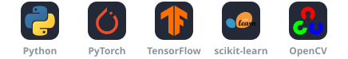
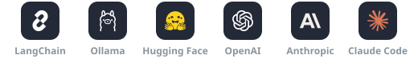
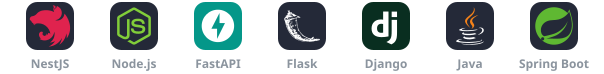
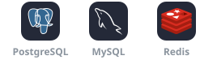
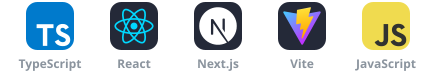
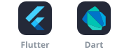

 

&nbsp;&nbsp;

&nbsp;&nbsp;

 

 

###  소개

모델부터 API, 화면까지 AI 서비스를 끝까지 만드는 개발자입니다. 2023년 7월부터 개발을 시작했고, AI를 실제 업무 시스템에 녹여 내는 일을 주로 합니다.

 

###  만들 수 있는 것

<table>
  <tr>
    <td colspan="2" valign="top">
      <h4>LLM 애플리케이션 &amp; RAG</h4>
      
      
      
      
       ChromaDB · Reranking · WebSocket
      <ul>
        <li>PDF·Office 문서를 파싱하고 잘게 나눠 임베딩한 뒤 벡터 저장소에 색인하는 문서 파이프라인</li>
        <li>재순위화를 거쳐 원본 파일 근거를 함께 보여 주는 답변</li>
        <li>권한을 따르는 검색: 회사별로 데이터를 나누고, 부서와 역할에 맞게 접근을 제한</li>
        <li>Ollama로 LLM을 직접 서빙해 문서가 회사 네트워크 밖으로 나가지 않는 구조</li>
        <li>고객사 자체 DB에 자연어로 묻고 답하는 채팅(토큰·응답 시간 한도 안에서)</li>
      </ul>
    </td>
  </tr>
  <tr>
    <td width="50%" valign="top">
      <h4>머신러닝</h4>
      
       Keras · XGBoost · pandas · Flask
      <ul>
        <li>여러 센서의 시계열 데이터 이상탐지: 회귀 모델과 오토인코더가 함께 이상이라고 판단할 때만 알람</li>
        <li>시계열 피처 엔지니어링(rolling·lag·diff 구간)과 학습 오차로 정하는 센서별 임계값</li>
        <li>작은 모델 여러 개를 학습하고 REST API로 서빙하는 파이프라인</li>
      </ul>
    </td>
    <td width="50%" valign="top">
      <h4>컴퓨터 비전</h4>
      
       YOLO · timm
      <ul>
        <li>사진 속 물건을 알아보고 세는 객체 탐지·인스턴스 세그멘테이션</li>
        <li>웹·모바일에서 쓰는 이미지 인식 모델을 REST API로 서빙</li>
      </ul>
    </td>
  </tr>
  <tr>
    <td width="50%" valign="top">
      <h4>풀스택 웹 &amp; 앱</h4>
      
       TypeORM · Vite · PostgreSQL · MySQL · Redis
      <ul>
        <li>NestJS·TypeORM REST API: 인증, 역할·권한, 조직 트리, 파일 처리, 라이선스</li>
        <li>React·TypeScript로 만드는 관리자 화면과 서비스 웹</li>
        <li>Flutter 크로스플랫폼 모바일 앱</li>
        <li>Nginx 뒤 Docker 배포, PostgreSQL·MySQL·Redis 운영</li>
      </ul>
    </td>
    <td width="50%" valign="top">
      <h4>품질 &amp; 보안</h4>
      
       Playwright · pytest · 뮤테이션 테스트
      <ul>
        <li>Playwright로 실제 화면을 도는 E2E 테스트 회차를 기능·보안·UX로 나눠 진행</li>
        <li>테스트가 실제로 실패할 수 있는지 뮤테이션 테스트로 확인하고, 판정마다 증거 파일을 남김</li>
        <li>설계 단계부터 넣는 보안: 접근 제어, 비밀값 관리, 데이터를 사내에 두기</li>
      </ul>
    </td>
  </tr>
</table>

 

 

###  기술 스택

<table>
  <tr>
    <td width="130"><b>AI / ML</b></td>
    <td></td>
  </tr>
  <tr>
    <td width="130"><b>LLM</b></td>
    <td></td>
  </tr>
  <tr>
    <td width="130"><b>Backend</b></td>
    <td></td>
  </tr>
  <tr>
    <td width="130"><b>Database</b></td>
    <td></td>
  </tr>
  <tr>
    <td width="130"><b>Frontend</b></td>
    <td></td>
  </tr>
  <tr>
    <td width="130"><b>Mobile</b></td>
    <td></td>
  </tr>
  <tr>
    <td width="130"><b>Infra / Tools</b></td>
    <td></td>
  </tr>
</table>

 

###  활동

<picture>
  <source media="(prefers-color-scheme: dark)" srcset="https://raw.githubusercontent.com/minu0508/minu0508/output/github-snake-dark.svg"/>
  <source media="(prefers-color-scheme: light)" srcset="https://raw.githubusercontent.com/minu0508/minu0508/output/github-snake.svg"/>
  
</picture>

  

<picture>
  <source media="(prefers-color-scheme: dark)" srcset="https://streak-stats.demolab.com?user=minu0508&amp;hide_border=true&amp;background=0D1117&amp;ring=39D353&amp;fire=39D353&amp;currStreakLabel=39D353&amp;sideLabels=C9D1D9&amp;currStreakNum=C9D1D9&amp;sideNums=C9D1D9&amp;dates=8B949E&amp;stroke=21262D"/>
  <source media="(prefers-color-scheme: light)" srcset="https://streak-stats.demolab.com?user=minu0508&amp;hide_border=true&amp;background=FFFFFF&amp;ring=1A7F37&amp;fire=1A7F37&amp;currStreakLabel=1A7F37&amp;sideLabels=57606A&amp;currStreakNum=24292F&amp;sideNums=24292F&amp;dates=6E7781&amp;stroke=D0D7DE"/>
  
</picture>

 

