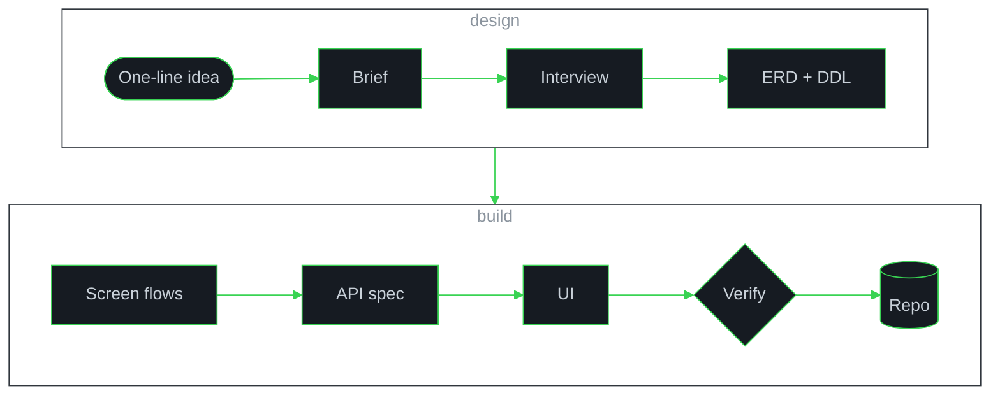

<div align="center">


<br/>


&nbsp;&nbsp;
<a href="https://solved.ac/smw508/"></a>
&nbsp;&nbsp;


</div>

<br/>

```python
class MinWoo:
    role    = ["AI Engineer", "Software Developer"]
    since   = "2023.07"
    years   = "3+"  # updated by GitHub Actions
    focus   = ["LLM Application", "RAG", "Agent System",
               "Time-series ML", "Computer Vision", "Full-stack"]
    stack   = ["Python", "TypeScript", "NestJS", "React", "Flutter", "Docker"]
    motto   = "Slow is fine. Quitting isn't. Keep growing."
```

###  About

I build AI services end to end: the model, the API around it, and the screen people use. I have been shipping software since July 2023, and most of my work sits where AI meets real business systems.

모델부터 API, 화면까지 AI 서비스를 끝까지 만드는 개발자입니다. 2023년 7월부터 개발을 시작했고, AI를 실제 업무 시스템에 녹여 내는 일을 주로 합니다.

<br/>

###  What I Can Build

<table>
  <tr>
    <td colspan="2" valign="top">
      <h4>LLM Applications &amp; RAG</h4>
      
      
      
      
      <br/><sub>ChromaDB · Reranking · WebSocket</sub>
      <ul>
        <li>Document pipelines that parse PDF and Office files, chunk and embed them, and index them in a vector store</li>
        <li>Answers grounded in sources, with reranking and citations back to the original file</li>
        <li>Permission-aware retrieval: data separated per tenant, access scoped by department and role</li>
        <li>Local LLM serving with Ollama, so documents never leave the company network</li>
        <li>Natural-language chat over a client's own database, kept inside token and time budgets</li>
      </ul>
    </td>
  </tr>
  <tr>
    <td width="50%" valign="top">
      <h4>Machine Learning</h4>
      
      <br/><sub>Keras · XGBoost · pandas · Flask</sub>
      <ul>
        <li>Anomaly detection on multivariate sensor time series, with regression and autoencoder models that must agree before an alarm</li>
        <li>Time-series feature engineering (rolling, lag and diff windows) and per-sensor thresholds learned from training error</li>
        <li>Training and serving pipelines for many small models behind a REST API</li>
      </ul>
    </td>
    <td width="50%" valign="top">
      <h4>Computer Vision</h4>
      
      <br/><sub>YOLO · timm</sub>
      <ul>
        <li>Object detection and instance segmentation for recognizing and counting items in photos</li>
        <li>Image recognition models served behind REST APIs for web and mobile clients</li>
      </ul>
    </td>
  </tr>
  <tr>
    <td width="50%" valign="top">
      <h4>Full-stack Web &amp; App</h4>
      
      <br/><sub>TypeORM · Vite · PostgreSQL · MySQL · Redis</sub>
      <ul>
        <li>REST APIs with NestJS and TypeORM: auth, roles and permissions, organization trees, file handling, licensing</li>
        <li>Admin consoles and service web in React and TypeScript</li>
        <li>Cross-platform mobile apps in Flutter</li>
        <li>Docker deployment behind Nginx, on PostgreSQL, MySQL and Redis</li>
      </ul>
    </td>
    <td width="50%" valign="top">
      <h4>Quality &amp; Security</h4>
      
      <br/><sub>Playwright · pytest · Mutation testing</sub>
      <ul>
        <li>End-to-end test rounds on the real UI with Playwright, split into functional, security and UX passes</li>
        <li>Mutation testing to prove tests can fail, and an evidence file behind every verdict</li>
        <li>Security designed in from the start: access control, secret handling, keeping data in-house</li>
      </ul>
    </td>
  </tr>
</table>

<br/>

###  How I Build

- **Agents as teammates.** Claude Code and Codex work as a pair: one plans and implements, the other reviews the plan and the diff.
- **Design factory.** A 10-stage agent pipeline that turns one sentence into a brief, an ERD with executable DDL, screen flows, an API spec, UI components and a scaffolded repo. Each stage is planned, reviewed, run and verified.
- **LLM Wiki.** A personal knowledge base in Obsidian that an LLM maintains: 100+ linked pages on AI tooling, with claims checked against primary sources.
- **Second brain for code.** Coding sessions are collected into the vault, summarized and indexed with gbrain, so past decisions, and who made them, stay searchable.

<details>
<summary><b>See the design factory pipeline</b></summary>
<br/>



<sub>Every stage runs plan → review → execute → verify before the next one starts.</sub>

</details>

<br/>

###  Stack

<table>
  <tr>
    <td width="130"><b>AI / ML</b></td>
    <td></td>
  </tr>
  <tr>
    <td width="130"><b>LLM</b></td>
    <td>     </td>
  </tr>
  <tr>
    <td width="130"><b>Backend</b></td>
    <td></td>
  </tr>
  <tr>
    <td width="130"><b>Database</b></td>
    <td></td>
  </tr>
  <tr>
    <td width="130"><b>Frontend</b></td>
    <td></td>
  </tr>
  <tr>
    <td width="130"><b>Mobile</b></td>
    <td></td>
  </tr>
  <tr>
    <td width="130"><b>Infra / Tools</b></td>
    <td></td>
  </tr>
</table>

<br/>

###  Activity

<div align="center">

<picture>
  <source media="(prefers-color-scheme: dark)" srcset="https://streak-stats.demolab.com?user=minu0508&amp;hide_border=true&amp;background=0D1117&amp;ring=39D353&amp;fire=39D353&amp;currStreakLabel=39D353&amp;sideLabels=C9D1D9&amp;currStreakNum=C9D1D9&amp;sideNums=C9D1D9&amp;dates=8B949E&amp;stroke=21262D"/>
  <source media="(prefers-color-scheme: light)" srcset="https://streak-stats.demolab.com?user=minu0508&amp;hide_border=true&amp;background=FFFFFF&amp;ring=1A7F37&amp;fire=1A7F37&amp;currStreakLabel=1A7F37&amp;sideLabels=57606A&amp;currStreakNum=24292F&amp;sideNums=24292F&amp;dates=6E7781&amp;stroke=D0D7DE"/>
  
</picture>

</div>

<br/>

<div align="center">

<a href="https://github.com/minu0508"></a>
<a href="mailto:devsormoo@gmail.com"></a>
<a href="https://instagram.com/mxxnw_s"></a>


</div>
