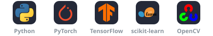
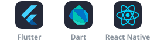

 

###  About

I build AI services end to end: I train the model, write the API around it, build the screen people use, and run it on the server. I have been shipping software since July 2023, and most of my work sits where AI meets real business systems.

I have trained models myself across vision, text and music, built full-stack products from the database to the mobile app, and set up and run the Linux servers they live on. I also treat AI as a working tool, not just a feature: coding agents, review loops and automated tests are part of how I ship.

 

###  What I Can Build

<table>
  <tr>
    <td colspan="2" valign="top">
      <h4>LLM Applications &amp; RAG</h4>
      
      
      
      
       ChromaDB · Reranking · WebSocket
      <ul>
        <li>Document pipelines that parse PDF and Office files, chunk and embed them, and index them in a vector store</li>
        <li>Answers grounded in sources, with reranking and citations back to the original file</li>
        <li>Permission-aware retrieval: data separated per tenant, access scoped by department and role</li>
        <li>Local LLM serving with Ollama, so documents never leave the company network</li>
        <li>Natural-language chat over a client's own database, kept inside token and time budgets</li>
      </ul>
    </td>
  </tr>
  <tr>
    <td width="50%" valign="top">
      <h4>Computer Vision</h4>
      
       YOLO · timm
      <ul>
        <li>Trained YOLO detectors myself, from dataset preparation to training and evaluation</li>
        <li>Object detection and instance segmentation for recognizing and counting items in photos</li>
        <li>Image recognition models served behind REST APIs for web and mobile clients</li>
      </ul>
    </td>
    <td width="50%" valign="top">
      <h4>Generative Models</h4>
      
      
       Magenta · KoGPT2 · Transformers
      <ul>
        <li>Melody generation with Magenta, trained myself on MIDI data</li>
        <li>Korean text generation by fine-tuning KoGPT2 in my own training runs</li>
        <li>From data preparation to sampling: what goes into training shapes what comes out</li>
      </ul>
    </td>
  </tr>
  <tr>
    <td width="50%" valign="top">
      <h4>Machine Learning</h4>
      
       Keras · XGBoost · pandas · Flask
      <ul>
        <li>Anomaly detection on multivariate sensor time series, with regression and autoencoder models that must agree before an alarm</li>
        <li>Time-series feature engineering (rolling, lag and diff windows) and per-sensor thresholds learned from training error</li>
        <li>Training and serving pipelines for many small models behind a REST API</li>
      </ul>
    </td>
    <td width="50%" valign="top">
      <h4>Linux &amp; Servers</h4>
      
       Docker Compose · GPU model serving · SSH
      <ul>
        <li>Setting up and running Linux servers for web, API and AI services</li>
        <li>Docker Compose deployments behind Nginx, with the database, API and model server side by side</li>
        <li>Serving local LLMs on GPU servers, kept inside the company network</li>
      </ul>
    </td>
  </tr>
  <tr>
    <td width="50%" valign="top">
      <h4>Full-stack Web &amp; App</h4>
      
       TypeORM · Vite · Thymeleaf · React Native · PostgreSQL · MySQL · Oracle · Redis
      <ul>
        <li>REST APIs with NestJS and TypeORM: auth, roles and permissions, organization trees, file handling, licensing</li>
        <li>Admin consoles and service web in React and TypeScript, and server-rendered pages with Spring Boot and Thymeleaf</li>
        <li>Cross-platform mobile apps in Flutter and React Native</li>
        <li>Relational databases from PostgreSQL and MySQL to Oracle</li>
      </ul>
    </td>
    <td width="50%" valign="top">
      <h4>Quality &amp; Security</h4>
      
       Playwright · pytest · Mutation testing
      <ul>
        <li>End-to-end test rounds on the real UI with Playwright, split into functional, security and UX passes</li>
        <li>Mutation testing to prove tests can fail, and an evidence file behind every verdict</li>
        <li>Security designed in from the start: access control, secret handling, keeping data in-house</li>
      </ul>
    </td>
  </tr>
  <tr>
    <td colspan="2" valign="top">
      <h4>AI-Native Development</h4>
      
      
       Claude Code · Codex · Custom skills &amp; hooks · Subagents
      <ul>
        <li>Coding agents in daily work, with custom skills, hooks and subagents fitted to my own workflow</li>
        <li>A second AI as reviewer: one model writes, another reviews, and tests decide</li>
        <li>A personal knowledge base in Obsidian that keeps decisions and lessons across sessions and projects</li>
      </ul>
    </td>
  </tr>
</table>

 

###  Stack

<table>
  <tr>
    <td width="130"><b>Languages</b></td>
    <td></td>
  </tr>
  <tr>
    <td width="130"><b>AI / ML</b></td>
    <td></td>
  </tr>
  <tr>
    <td width="130"><b>LLM</b></td>
    <td></td>
  </tr>
  <tr>
    <td width="130"><b>Backend</b></td>
    <td></td>
  </tr>
  <tr>
    <td width="130"><b>Database</b></td>
    <td></td>
  </tr>
  <tr>
    <td width="130"><b>Frontend</b></td>
    <td></td>
  </tr>
  <tr>
    <td width="130"><b>Mobile</b></td>
    <td></td>
  </tr>
  <tr>
    <td width="130"><b>Infra / Tools</b></td>
    <td></td>
  </tr>
</table>

 

###  Activity

<picture>
  <source media="(prefers-color-scheme: dark)" srcset="https://raw.githubusercontent.com/minu0508/minu0508/output/github-snake-dark.svg"/>
  <source media="(prefers-color-scheme: light)" srcset="https://raw.githubusercontent.com/minu0508/minu0508/output/github-snake.svg"/>
  
</picture>

  

<picture>
  <source media="(prefers-color-scheme: dark)" srcset="https://streak-stats.demolab.com?user=minu0508&amp;hide_border=true&amp;background=0D1117&amp;ring=39D353&amp;fire=39D353&amp;currStreakLabel=39D353&amp;sideLabels=C9D1D9&amp;currStreakNum=C9D1D9&amp;sideNums=C9D1D9&amp;dates=8B949E&amp;stroke=21262D"/>
  <source media="(prefers-color-scheme: light)" srcset="https://streak-stats.demolab.com?user=minu0508&amp;hide_border=true&amp;background=FFFFFF&amp;ring=1A7F37&amp;fire=1A7F37&amp;currStreakLabel=1A7F37&amp;sideLabels=57606A&amp;currStreakNum=24292F&amp;sideNums=24292F&amp;dates=6E7781&amp;stroke=D0D7DE"/>
  
</picture>

 

